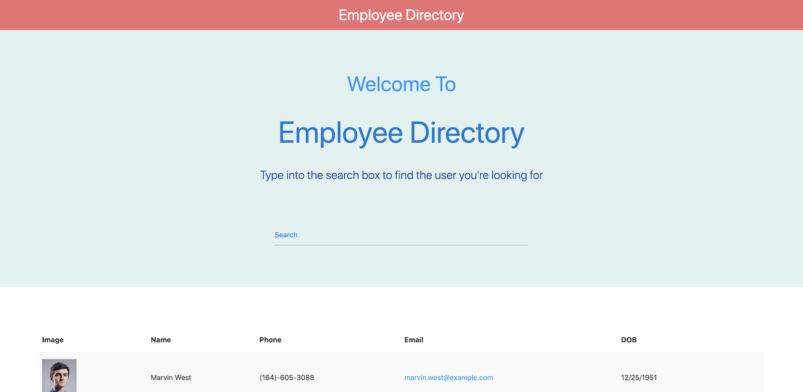

# Employee Directory



A React app that loads a directory of employees and lets you filter and sort
them from the browser — no backend, no pagination, everything held in component
state.

**Live:** https://pablomotta.github.io/employee-directory/

## What it does

On mount it fetches 200 US users from the [Random User
API](https://randomuser.me) and renders them into a table.

- **Filter** — typing in the search box narrows the table as you go. Each row's
  fields are joined and lowercased, so a query matches against name, email or
  phone without having to pick a column first.
- **Sort** — clicking a column heading sorts by it and flips between ascending
  and descending on each subsequent click.

## Running it

Requires [Node.js](https://nodejs.org/en/) and npm.

```bash
git clone git@github.com:pablomotta/employee-directory.git
cd employee-directory
npm install
npm start
```

The app opens at http://localhost:3000.

| Command | What it does |
|---|---|
| `npm start` | Development server |
| `npm test` | Test runner in watch mode |
| `npm run build` | Production build into `build/` |
| `npm run deploy` | Builds and publishes to the `gh-pages` branch |

## Stack

React 16 · Create React App · axios · Random User API

## Author

**Pablo Motta** — [github profile](https://github.com/pablomotta)
